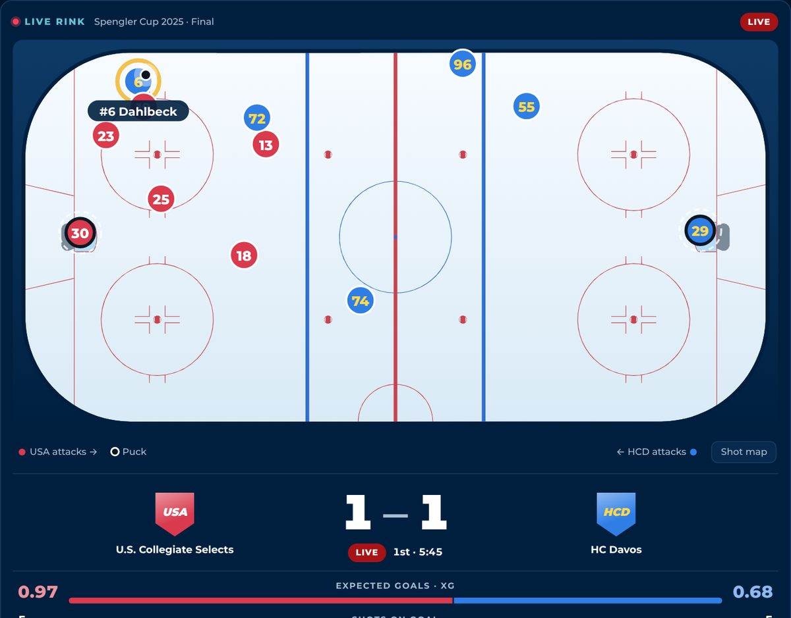
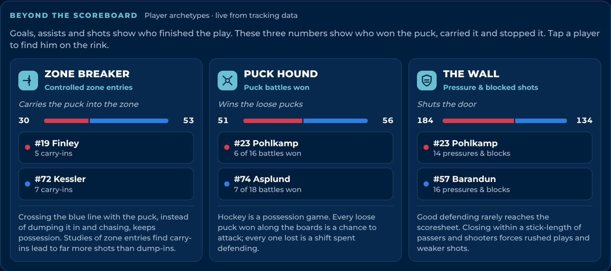
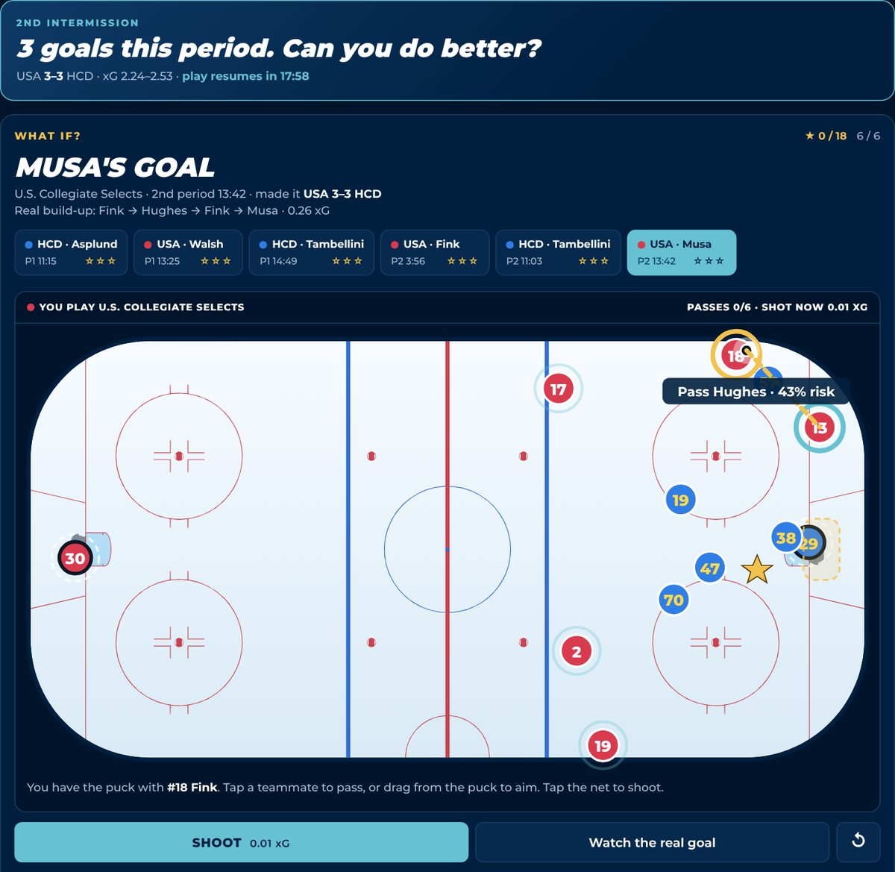

# Spengler Cup · Live Rink

**Follow a hockey game without the broadcast, understand what actually decided it, and replay every goal your way.**

A drop-in module for a match page, built on Wisehockey tracking data. Live demo, a replay of the 2025 Spengler Cup final (HC Davos 6–3 U.S. Collegiate Selects): **https://spengler.shubhamruhe.la**



## What it does

**Live rink.** A 2D recreation of the game: all twelve players and the puck move as tracking events arrive. Under it sit the score, clock and strength, expected goals (xG) for both teams, shots on goal, a period table and the key moments.

**Beyond the scoreboard.** Goals and shots show who finished a play. Three player archetypes, updated live, show who made it happen: the **Zone Breaker** carries the puck into the attacking zone, the **Puck Hound** wins the loose pucks, and **The Wall** pressures and blocks. Each card explains why its stat matters and shows each team's leader. Tap one to find him on the rink.



**What If?** Every goal becomes a mini-game. You get the puck three passes before the real goal, with the real players in their real positions. Pass to beat a defence that reacts to every move (the line shows interception risk before you commit), then shoot, and see whether your chance beats the real one. "Watch the real goal" replays what actually happened.



**Built around the match rhythm.** During play the rink is on top. At each intermission and at full time the page reorganises itself: What If? moves to the top with a countdown to the next period, then steps back when the puck drops.

## How it works

- **Smooth motion from sparse data.** Wisehockey sends a snapshot of every player at each event, roughly once a second. The widget generates the frames in between, like frame generation in games: players follow curves shaped by their measured velocities, the puck rides on the carrier's stick, and whoever touches the puck is drawn to it. The tracked puck sits a median 1.6 m from its carrier in the raw data. After smoothing, a player is within 1 m of the puck at 97% of possession changes, up from 22%.
- **Stats you can check.** Archetype numbers come straight from the event stream and match an independent recomputation exactly. Puck battles and pressure also track Wisehockey's official totals (r = 0.72 and 0.78).
- **Grounded game physics.** The What-If interception model is calibrated on the game's 602 real passes: average predicted risk 14% against a real interception rate of 13%. Shot quality is fitted on the game's 110 Wisehockey xG values.
- **Plug-and-play, any match.** One `<script>` tag and one element, or a single `<iframe>`. Team names, players, goalies, attacking direction, score and strength all come from the data. It also runs live from rows in Wisehockey's own export format. Tested by running the final disguised as a different match (teams swapped, players renamed, teams changing ends every period): it produced the exact mirror of the real game.
- **Light and private.** 26 KB (compressed), no frameworks; it works on phones, tablets and desktops. The match data isn't in this repository: it's licensed, so it sits in private Cloudflare storage and is served only to the site.

```html
<script src="https://spengler.shubhamruhe.la/spengler-live.min.js" defer></script>
<spengler-live-match feed-url="wss://…" home-name="HC Davos" home-code="HCD" away-name="Frölunda HC" away-code="FRO"></spengler-live-match>
```

## Built with

Vanilla JavaScript web component (Shadow DOM) · SVG rink geometry from [hockey_rink](https://github.com/the-bucketless/hockey_rink) · Cloudflare Workers + R2 · Python for data preparation. Running it, deploying it and loading other matches: [docs/DEPLOY.md](docs/DEPLOY.md).

## Licence

[CC BY-NC 4.0](LICENSE): free for non-commercial use with attribution; commercial use needs permission. Third-party parts are listed in [NOTICE.md](NOTICE.md).
